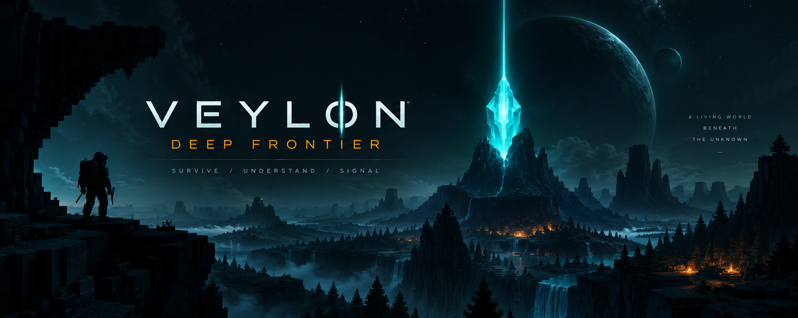

<p align="center">
  
</p>

# VEYLON: Deep Frontier

A first-person 3D voxel survival simulation for Windows and macOS, built with
**Java 25 + LWJGL 3 + OpenGL 3.3 + OpenAL + JOML**. No game engine or external
game-art pack: terrain textures, item icons, particles, articulated cuboid models
and **every sound** are generated by project code. GLSL shaders and the licensed
Source Sans 3 font are bundled as classpath assets.

A new world is **an abandoned city** on Veylon: a streamed metropolis of six districts
(reclaimed flats, a commercial downtown, industrial yards, flooded streets, a civic and
medical precinct and an alien-grown quarantine) in which **every building can be
entered** — apartments, shops, clinics, schools, offices, security posts and warehouses,
with basements, service passages, transit tunnels and rooftop routes. You wake in a small
refuge and live on what the city still holds: searching a cupboard, a fridge or a locker
takes time and makes noise, and what you take stays gone. The **Veilbound**, colonists
changed by an alien membrane, hunt by sound and sight; the **Veilmaw** and the
**Breacher** grow out of the quarantine. Small **survivor camps**, guarded
**strongholds**, a raider yard and **civilians hidden in sealed cellars** remember how you
treat them. Claim and barricade a refuge, fit taps, a generator, lamps and a water
purifier from salvage, take work from survivors and bring the old **radio relay** back,
then keep surviving. No tree needs felling and no ore needs mining.

The **wilderness** of releases 0.3.0 to 0.8.1 stays on offer as the legacy world, and a
save always reopens the world it was made in. There you crash-land on Veylon, a living
planet fragment: chunk-based voxel terrain with six
biomes, **three-zone deep caves**, ores and procedural points of interest; dynamic
weather, **seasons**, temperature, cellular water, spreading fire and growing plants;
wildlife that leaves **tracks and blood trails**, smells your scent and hears your
noise; a deep body simulation with **nutrition, spoilage, medical conditions, gear and
carry weight**; a frontier of **procedurally planned settlements** — friendly villages,
neutral homesteads, hostile Headhunter forts, castles and rare fortresses — with
residents who **sleep, work, patrol and defend**; **bows, black-powder firearms and
explosives** with a shared projectile and noise-perception simulation; an NPC starter
camp with **trust tiers, quests, settlement upgrades and raids**; and a long-term goal —
find blueprints, master the crafting stations and **repair the distress beacon**.

---

Version **0.9.0 — The Abandoned City** makes an abandoned city the new world: six
districts whose every building can be entered and searched, infected and alien
threats, survivor camps, hidden civilians, guarded strongholds and a raider yard, a
refuge to claim, barricade and power from salvage, and the old radio relay to bring
back. The wilderness of earlier releases stays on NEW FRONTIER as the legacy world, and
existing saves keep their world. Releases up to 0.8.1 cannot open a city save. See the
[release notes](docs/releases/v0.9.0.md) and the
[urban survival records](docs/urban-survival/PROGRESS.md).

Version **0.8.1 — Living Bodies & Fire** extends lethal blast dismemberment to
every animal and the Survival player. Flames cling to living bodies, make people
and animals flee, and follow them onto their remains. Animal torsos retain their
harvest and lodged arrows. Existing saves remain compatible. See the
[release notes](docs/releases/v0.8.1.md) and
[engineering record](docs/engineering/ALL_LIVING_COMBAT_FIRE.md).

Version **0.8.0 — Lethal Combat & Molotov Fire** makes a head shot fatal and a chest
take two bullets or three arrows, kills and dismembers everyone inside a bomb's
lethal radius, and turns the fire bomb into a molotov that spills spreading liquid
fire. Rain now puts exposed fires out. Existing saves remain compatible. See the
[release notes](docs/releases/v0.8.0.md) and
[engineering record](docs/engineering/COMBAT_LETHALITY_AND_MOLOTOV.md).

Version **0.7.4 — Articulated Ragdolls** gives dying bodies bending elbows, knees
and hocks, a jointed neck and head, two-link tails and loose bird wings. Contacts,
not a preset pose, decide how a body lands or drapes over a ledge, and saves keep
that pose. Existing saves remain compatible. See the
[release notes](docs/releases/v0.7.4.md) and
[validation record](docs/engineering/RAGDOLL_VALIDATION.md).

Version **0.7.3 — HUD Visual Overhaul** brings larger survival vitals and hotbar
slots, clearer weapon and interaction feedback, compact context and mission
cards, and a matching Creative status panel. Existing saves remain compatible.
See the [release notes](docs/releases/v0.7.3.md).

Version **0.7.2 — Death Ragdolls & Blood** adds articulated death physics,
persistent human corpses, landed carcass poses and blood effects. Existing saves
remain compatible. See the [release notes](docs/releases/v0.7.2.md).

Version **0.7.1 — Physical Rain** brings wind-driven world-space drops that strike
roofs, terrain, foliage and water, with tiny impact droplets. Outdoor rain remains
visible from shelter. See the [release notes](docs/releases/v0.7.1.md) and
[validation record](docs/engineering/v0.7.1-validation.md).

Version **0.7.0 — Stone & Sky** added a **Creative mode**: an invulnerable body with no
needs, flight, instant building, a searchable catalog of every item, wildlife and
settlers that ignore you, and builder's controls over time, weather and spawning.
Survival plays exactly as it did in 0.6.0.

Version 0.6.0 — Signal & Silence added 44.1 kHz layered weather, wide ambience,
positioned fire, optional environment reverb and occlusion, distance-delayed
thunder, four-take sound banks and sparse synthesized music. Open **AUDIO** on the
title screen or press **V** while paused to adjust master, effects, ambience,
music and mute. Music at zero disables it; settings persist across launches.

## Game modes

**NEW FRONTIER** chooses the world and how it plays. It opens on **the abandoned city**;
**W** switches to **the wilderness**, labelled as the legacy world. Every world is
**Survival** or **Creative** (**S** / **C**), changeable later from the pause menu with
**G**. For the same seed and world, the city and its refuge (or the terrain and the
camp), the starter kit and the first wildlife are identical in either mode.

NEW FRONTIER also shows the **seed** the new world will be built from, a new one every
time. **E** (or a click on the field) types your own: a number is the seed itself, and any
other words are turned into one, so the same words always make the same world. **R**
rolls another. The pause menu names the world you are in with its seed, so you can share
it or come back to it.

**Survival** is the game as it has always been: you can be hurt and killed, needs drain,
predators hunt you and everything costs what it costs.

**Creative** is for building and exploring. You cannot be harmed and have no hunger,
thirst, temperature, fatigue, carry weight or injuries. Nothing detects, hunts or attacks
you, though reputation, ownership, theft and vandalism still count — only the
consequences that need someone to notice you are gone. You fly, break any block
instantly without drops or tool wear, place without spending the stack, and take
anything from the catalog. Crafting, cooking, drying, smelting, fuelling, trade, gifts
and quest deliveries still cost their normal inputs; only using an item up for its own
effect is free.

The first switch to Creative **permanently marks that world as a Creative world**. You
can return to Survival whenever you like, but the mark stays and is shown in the pause
menu and on the victory screen. Each of the three save slots holds one world of either
kind in either mode; NEW FRONTIER asks which slot a new world goes into, and asks again
before it replaces a save (see [Save format](#save-format)).

## Requirements

- Windows 10/11 (x64), or macOS on Apple Silicon (arm64) / Intel (x64)
- JDK **25** on `PATH` (`java -version` should report 25.x). The Gradle wrapper downloads
  Gradle 9.1 automatically on first run.
- A GPU/driver with OpenGL 3.3. Audio uses OpenAL (bundled native); if no audio device
  exists, the game runs silently.

> **Windows corporate proxy note:** If the very first wrapper download fails with an
> SSL error behind a managed proxy, run once with:
> ```powershell
> $env:GRADLE_OPTS = "-Djavax.net.ssl.trustStoreType=Windows-ROOT"
> ```

## Run (PowerShell)

```powershell
.\gradlew.bat run
```

## Run (macOS)

```bash
./gradlew run
```

On Windows, the three save slots and their backups go to a `saves` folder
(`saves\slot-1.sav` and so on), with the settings files beside it, in the working
directory the game is started from. On macOS, saves and the graphics, audio, autosave
and mouse settings go under
`~/Library/Application Support/VEYLON Deep Frontier/`. A build opens only the
saves of its own **save epoch**: saves written by 0.9.0 and earlier releases are
refused with a message and left untouched, and need a new world (see
[Save format](#save-format)).

## Build & distribute

The native dependencies and self-contained app-image are selected for the current
host architecture. Build each package on its target operating system.

Windows x64 (PowerShell):

```powershell
.\gradlew.bat build             # compile + unit tests + jar
.\gradlew.bat performanceTest   # opt-in benchmarks calibrated for the reference PC
.\gradlew.bat fatJar            # build\libs\veylon-0.9.0-all.jar
.\gradlew.bat jpackage          # build\jpackage\Veylon\Veylon.exe
.\gradlew.bat appImageZip       # build\distributions\veylon-0.9.0-windows-x64.zip
.\gradlew.bat releaseArtifacts  # tests + all host-specific release artifacts
```

macOS Intel or Apple Silicon (Terminal):

```bash
./gradlew build
./gradlew fatJar
./gradlew jpackage          # build/jpackage/Veylon.app
./gradlew appImageZip       # build/distributions/veylon-0.9.0-macos-{x64|arm64}.zip
./gradlew releaseArtifacts
```

The tag-triggered [release build workflow](.github/workflows/release-build.yml) builds
and validates three self-contained archives — Windows x64, macOS Apple Silicon and
macOS Intel — then publishes them together in the matching GitHub Release with a
`SHA256SUMS.txt` file. The macOS archives are currently unsigned and not notarized;
macOS may therefore require an explicit approval in **System Settings → Privacy &
Security** on first launch.

To recover an unpublished release after a workflow failure, run the current
workflow manually with `release_tag` set to the existing tag (for example,
`v0.8.1`), or push its workflow fix to `release-recovery/v0.8.1`. Both paths
resolve the existing tag to one commit and rebuild all three platforms from
that exact source before publishing. They do not move the tag. A manual run
from a regular branch without `release_tag` only builds that ref. Intel jobs allow 60 minutes;
other platforms allow 30. Build logs include test progress, and test reports
are uploaded separately as `test-diagnostics-*` artifacts, including on failure
when reports are available. Recovery is for releases that have not yet been
published; an existing release is not overwritten.

Automated OpenGL smoke test (opens a window and auto-exits; exercises save/load,
equipment, fire and storm). It runs in the city; set `VEYLON_GENERATOR=wilderness` for
the wilderness smoke, which also approaches a generated fortress:

```powershell
$env:VEYLON_SMOKE = "30"; .\gradlew.bat run
```

The default new-world path itself (title, NEW FRONTIER, play, F5, quit, relaunch, load)
has a native route, `VEYLON_FRONTEND=route` then `route-load`, and every state of the
slot picker has `route-slots`; see
[Developing](docs/DEVELOPING.md#default-path-acceptance-urban-package-26). No automated
run autosaves unless `VEYLON_AUTOSAVE=on` asks; the autosave tour `urban_autosave` needs
it (see [Developing](docs/DEVELOPING.md#autosave-qa-091-milestone-05)), and so does
`route-release`, which plays 0.9.1's whole acceptance scenario in either world and mode
(see [Developing](docs/DEVELOPING.md#release-acceptance-qa-091-milestone-09)).

Release performance gate on the validation machine:

```powershell
$env:VEYLON_SMOKE = "30"
$env:VEYLON_VSYNC = "0"
$env:VEYLON_MIN_FPS = "60"
.\gradlew.bat run
```

The same variables can be exported from a macOS shell, for example
`VEYLON_SMOKE=30 VEYLON_VSYNC=0 VEYLON_MIN_FPS=60 ./gradlew run`.

See [CHANGELOG.md](CHANGELOG.md) for release notes.

Run the fat JAR with the same JVM options used by the packaged launchers:

```powershell
java --enable-native-access=ALL-UNNAMED -Xmx2G -jar build\libs\veylon-0.9.0-all.jar
```

---

## Controls

| Key | Action |
| --- | --- |
| `WASD` | Move |
| Mouse | Look (its sensitivity and invert-Y under **CONTROLS**) |
| `Space` | Jump / swim up / **climb rope ladders** |
| `Left Shift` | Sprint (drains stamina, makes noise) |
| `Left Ctrl` | Crouch — stealth (humans and predators detect you at half range) and **read animal tracks** |
| `LMB` (hold) | Mine block / attack — **with a bow: hold to draw, release to fire; with a firearm: fire; with a bomb: throw** (crouched melee hits 40% harder) |
| `RMB` | Place block, **eat / drink / apply medicine / equip gear**, use station |
| `R` | **Reload the held firearm** (in the crafting screen, `R` still cycles station tabs) |
| `F` | Interact: talk, harvest bush/herbs/**carcass**, cook/boil/fuel campfire, drying rack, rain collector, **sleep** on bedroll, fill waterskin, repair **beacon**, **recover arrows, open gates, ring bells, light powder-keg fuses, free captives, claim cleared outposts** |
| `E` | Inventory + **equipment slots** (click gear slot to equip/unequip) |
| `C` | Crafting — `Q`/`R` cycle station tabs, `W/S` select, `Enter` craft |
| `1-9`, scroll | Hotbar selection |
| `Tab` | Simulation panel |
| `M` | Map (camp, **discovered POIs/settlements**, fortress rumors, services, beacon); in a city, the **city map and journal** |
| `F` in a city | Search a container (time and noise), open or close a door or window; **crouched, bar a door** from your side |
| `LMB` held, crouched, in a city | **Take a piece apart** for salvage (furniture, fixtures, burnt-out cars) |
| `P` | Pause simulation |
| `Esc` | Pause menu / close screen / wake up early |
| `G` (paused) | **Game mode — switch this world between Survival and Creative** |
| `T` (paused, Creative) | **World controls — time of day, freeze daylight, weather and its lock, wildlife spawning** |
| `Space` twice (Creative) | **Start or stop flying** |
| `Space` / `Left Ctrl` / `Left Shift` (flying) | **Rise / descend / fly faster** |
| `E` (Creative) | **Creative catalog — browse or search every item, `1`-`9` fills a hotbar slot** |
| `MMB` (Creative) | **Pick the block you are looking at** |
| `O` (paused) | Graphics options |
| `V` (title or paused) | Audio options: live sliders, Apply/F5 saves, Back/Esc restores |
| `A` (title or paused) | Autosave options: on or off, and every 5, 10, 15 or 30 minutes of play; Apply/F5 keeps them, Back/Esc restores |
| `C` (title or paused) | Controls: mouse sensitivity from 10% to 300% (100% is the turn of earlier releases) and invert mouse Y; Apply/F5 keeps them for the next launch, Back/Esc restores |
| `R` (paused) | **Return to the title**: `Enter` saves into the world's slot first, `N` returns without saving and leaves the slot as it was, `Esc` stays |
| `Q` (paused) | Quit the game |
| `E` / `R` (NEW FRONTIER) | Type a seed (a number or any words; `Enter` or `Esc` finishes it) / roll a new one |
| `F3` | Debug overlay |
| `F5` / `F9` | Save into / load the world's slot: the one it was loaded from or started in (the pause menu names it) |
| `1`-`3`, arrows (slot picker) | Choose a slot; `Enter` loads it or starts the new world in it, `R` restores a damaged slot's backup, `Del` deletes a slot; replacing, restoring and deleting ask first |

## The city

1. **The refuge:** you wake in a ground-floor flat off a courtyard, with a bed, a
   kitchen workbench and a day of food and water in its cupboards. Close the doors;
   crouch and press `F` to bar one from your side. The courtyard's collector fills in
   rain and its fire cooks and boils.
2. **Scavenging:** `F` searches a cupboard, fridge, wardrobe or locker. Contents stay
   hidden until the search ends, every search takes time and makes noise, and what you
   take never comes back. Survivors' stores are theirs: taking from them is theft.
3. **The first upgrade:** one trip next door funds it. Scrap, planks and textiles make a
   **reinforced spear** at the workbench; utility lockers hold a **pry tool** that forces
   locked doors and armouries, loudly.
4. **Threats:** the Veilbound hear searches, footsteps and forced doors and see you in
   the light; break their line of sight, close a door or fight. The **Breacher**
   hammers through plank barricades; the **Veilmaw** shows its glow before it strikes.
   Contaminated ground and alien growth mark the quarantine.
5. **Districts decide trips:** flats and grocers feed you, clinics treat you, warehouses
   and industrial yards hold tools and parts, security posts keep weapons behind locks;
   flooded streets and the quarantine cost more to cross. Basements, service passages,
   transit tunnels and fire escapes connect what streets do not.
6. **People:** camps talk, trade and give work; hidden civilians can be heard before
   their cellar's loose panel is found; a stronghold keeps its gate and its rules, and a
   raider yard takes what it can. Help, theft and violence are remembered.
7. **A better home:** claim up to three flats by their beds, barricade doors and windows
   from salvage, and take furniture and burnt-out cars apart (crouch and hold `LMB`).
   Taps hold only what is left in their building's pipes; a generator fed from intact
   car tanks runs work lamps, a water purifier or a radio on its building's circuit.
8. **The long goal:** ask survivors about the **old radio relay**, recover its three
   parts across the districts, earn its codes or scan the band for them, repair it, and
   broadcast from a radio at your refuge. The city answers; the game goes on.
9. **Dying** wakes you at your refuge with what you carried. `M` opens a city map of
   the streets you have walked, the buildings you entered, your home, the sites you
   found and your objectives, with a journal and a sketch of the storey underfoot.

## The wilderness loop

1. **First day:** punch trees, gather fiber and berries, craft a spear and campfire.
   Fill your waterskin (`F` at water) — it's *dirty*; **boil it at a campfire** or you
   risk food poisoning.
2. **Stay healthy:** wolf bites cause **bleeding** (bandage it, or it festers into a
   feverish **infection**); falls cause **sprains** (splint); fire causes **burns**
   (herbal poultice); bad food causes **poisoning** (medicine). Eat both meat *and*
   plants — the protein/vitamin bars gate your health regen and stamina.
3. **Food logistics:** raw meat spoils in minutes. Cook it (lasts longer) or build a
   **drying rack** — dried meat and berries keep for days. Cold biomes slow spoilage.
4. **Hunt properly:** animals drop **carcasses**. Craft a bone knife to skin them for
   meat, **hide** and bone. Carrying raw meat or bleeding makes wolves smell you;
   sprinting and mining make noise. Crouch to stalk — and to read tracks.
5. **Gear up:** tan hide into leather (**tannery**), sew coats, boots, hood, pants and a
   **backpack** (+14 kg). Insulation beats the cold, the rain cloak beats wetness, armor
   blunts attacks. Everything has **durability**. Watch your **carry weight** — overload
   and you can't sprint.
6. **Stations:** Workbench → tools, racks, furnace, tannery, herbalist bench, map table,
   rain collector, bedroll, waterskin. **Furnace** smelts copper/iron (needs coal).
   **Anvil** forges iron tools, weapons and armor. **Herbalist bench** brews antiseptic,
   poultices and medicine. **Campfire** cooks, boils and chars logs to charcoal.
7. **Shelter & sleep:** build a roof and walls — being *Indoors* blocks rain and wind
   chill. Sleep on a **bedroll** at night (or fatigued); sleeping cold, wet and exposed
   risks sickness, and a campfire indoors without ventilation causes **smoke inhalation**.
8. **Explore:** the world generates **crash debris, research pods, ancient ruins,
   predator dens and supply caches**. Discovery marks them on the map. Pods and caches
   hold **blueprint fragments** — decode them at a **map table** to unlock the rain
   cloak, iron armor and the **beacon frame**.
9. **The camp:** trade, gift, and take **camp requests** (food, wood, medicine, ore,
   predator hunts, scouting). Trust tiers: Wary → Neutral → **Friendly** (camp beds,
   medic heals you, trade discounts) → **Allied** (supply gift, beacon calibration).
   The camp grows: palisade and watch post, beds and storage, finally a medical tent.
   Defend it from **wolf raids and scavenger attacks** — or watch its stocks bleed.
10. **The frontier:** the world is planned in regions — each can host at most one
    settlement. **Villages are common; forts uncommon; castles rare; fortresses very
    rare** and far from spawn. Friendly and neutral communities trade, gossip and
    remember how you treat them: gifts, trade, defense and rescues win them over;
    theft, wrecked property and violence turn them hostile. **Headhunter** forts
    field trackers, bow scouts, spear hunters, armored brutes, musket powdermen and
    a leader whose death breaks the garrison's morale.
11. **Ranged combat:** craft a **primitive bow** and arrows for quiet hunting (recover
    arrows from carcasses and surfaces). Deep-cave **sulfur + saltpeter + charcoal**
    makes **black powder**; the anvil forges a **musket**, **flintlock** and
    **blunderbuss** — devastating, but slow to reload, and every shot is a huge noise
    event that draws predators and alerts settlements. Against **people**, where you
    hit decides the fight: a bullet or an arrow **in the head kills outright**, and
    the chest takes **two bullets or three arrows** whoever they are and however
    much health they have — an arrow wound counts for less than a bullet's, and
    wounds from both add up. Limbs still only cost the weapon's own damage.
    **Powder kegs** breach weak gates and walls, and anyone caught close by a keg or
    a **scrap bomb** is killed and **blown apart** by it. A scrap bomb is thrown with
    a lit fuse; a **fire bomb** is a molotov that **breaks on the first thing it
    hits** and spills burning liquid.
12. **Siege & capture:** infiltrate a hostile fort through a rear gap, sabotage the
    **alarm bell**, free **captives**, rout or defeat the garrison and its leader —
    a cleared settlement stays cleared, and supplying its campfire with food and logs
    turns it into a **friendly outpost** (safe beds, storage, limited trade — and counterattacks).
13. **Go deeper:** every region has a reserved **ladder-shaft cave mouth** connected
    to its required underground POIs. Root
    caves (roots, dens, early ore) give way to **basalt depths** (sulfur, saltpeter,
    iron, glow fungus — and smoking **fumarole vents** that choke you until you mine
    them out) and rare **resonant depths** with crystal chambers. Craft **rope
    ladders**, a **lantern** and cheap **trail markers** to survive the descent;
    gloomstalkers nest in the dark, ambush from the flanks and fear your fire.
14. **Endgame:** forge a **Beacon Frame** (anvil + blueprint), place it, install a
    **signal crystal** (mine the resonant core in ancient ruins), wire it with copper
    ingots, and get the camp's calibration codes at **Allied** trust. Light it up.
    Relic weapons — the **Frontier Carbine** and **Scavenged Auto-Rifle** — exist only
    as extremely rare loot in research pods and fortress armories, feed on scarce
    cartridges and are restored (not crafted) at an anvil with relic components.

## What's simulated

- **City**: a connected, streamed metropolis planned in regions, with six districts that
  change architecture, supplies, hazards, creatures and climate; buildings whose rooms,
  stairs, windows and exits are proven reachable before they are built; contextual
  containers rolled once from stable ids and never refilled; infected, alien and wildlife
  encounters anchored to the plan, whose deaths persist; camps, hidden refuges,
  strongholds and a raider yard whose people keep their needs, deaths and opinion of
  you; claimed refuges, barricades, salvage, finite taps and small power circuits; city
  missions and the relay; far chunks dropped and regenerated block for block on long
  journeys.
- **Body**: health, hunger, thirst, stamina, body temperature, fatigue, wetness,
  **protein/vitamin nutrition**, and seven medical conditions (bleeding, infection,
  sprain, burns, food poisoning, sickness, smoke inhalation) — each with causes,
  symptoms and treatments.
- **Items**: per-stack **spoilage timers** (temperature-dependent), tool/gear
  **durability**, item weight and **carry capacity**, five equipment slots with
  insulation / rain resistance / armor stats that degrade.
- **World**: 6 biomes, three-zone deep caves (root / basalt / resonant), ores including
  **sulfur and saltpeter**, lakes, **12 POI types** above and below ground, guaranteed
  regional cave entrances, wild herbs and **glow fungus**, deterministic seed;
  **seasons** (Mild/Wet/Frost/Dry, 6 days each) bias weather, temperature, growth
  and wildlife.
- **Settlements**: deterministic regional planning (camp → village → fort → castle →
  fortress), biome-adapted modular buildings with stepped foundations and stilts,
  walls/gates/watchtowers/keeps, per-settlement stocks, morale, alert level, local
  reputation, dormant off-screen population simulation, capture/occupation with
  counterattacks, captives to rescue, and a regional bounty that sends hunter parties
  out from real hostile settlements.
- **Human AI**: bounded voxel A* pathfinding (gates, ladders, step-up/step-down) with
  steering fallback, daily routines (sleep/work/patrol/guard), block-occluded sight,
  hearing via positional **world noise events** (gunshots, explosions, alarms),
  last-known-position searches, alarm bells, friendly-fire-aware archers and
  powdermen, and morale-driven routs.
- **Combat**: data-driven weapon definitions shared by player and NPCs; arrows with
  drop, recovery and sticking; muzzle-loaded firearms with reload timing, recoil and
  huge noise footprints; **hit zones on people** (head, chest and legs, read from
  where the shot entered the body, and the same for shots NPCs fire at each other);
  a reusable explosion system with distance falloff, cover
  occlusion, blast resistance (ancient/progression blocks are blast-proof), bounded
  powder-keg chains and single-batch world edits, plus a **lethal radius** inside
  which a blast kills every living body outright — every kind of person, every
  animal and a Survival player — and **tears it apart at its own joints** (a person
  into ten pieces, a wolf into twelve, a hare or a bird into seven) that fly, bounce,
  settle where the terrain puts them, rot like corpses and survive a save; an
  animal's meat and hide stay on its torso, to be harvested once.
- **Fire**: burning blocks spread to flammable neighbours and **climb trees and
  walls**; **rain, storm and snow put out any fire open to the sky** within seconds
  and leave its block unburnt, while fires under a roof or a canopy burn on. A
  **fire bomb** spills a pool of burning liquid that runs downhill and around
  obstacles, lights what it touches and sets off powder kegs beside it.
- **Burning bodies**: burning liquid, burning blocks, fueled campfires, placed torches
  and a fire bomb breaking on a body **set it alight** — people, animals and the
  Survival player alike — with flames that stand on its limbs and keep burning
  after it leaves the fire, char it as they burn, and die down or are put out by
  deep water or open rain. **Burning people and animals panic** and run (birds fly)
  until the fire is out; the player keeps full control. A body that dies alight
  keeps burning briefly on its corpse, carcass or pieces. Creative players never
  catch fire.
- **Shelter**: roof and wall-enclosure detection — affects wetness, storm wind chill,
  sleep quality and indoor campfire smoke.
- **Wildlife**: Glowdeer, Ashwolves, Skitterwings, **Murkhares, Thornhorns (charge when
  wounded), Gloomstalkers (cave predators)**. Predators hear noise, smell blood/meat,
  follow **blood trails**, scavenge **carcasses**, den at POIs, and fear fire/light.
  Animals leave fading **footprints** readable while crouched.
- **NPC camp**: jobs (guard, hunter, gatherer, medic), needs, sickness, quests,
  **staged settlement upgrades**, predator/scavenger **raids**, trust tiers with real
  perks, and a trader who buys hide for blueprint fragments.
- **Events**: storms with lightning fires, cold snaps, heat waves, drought, berry bloom,
  predator migration, **toxic fog (stay indoors), ashfall (kills growth + darkens sky),
  meteor showers, camp illness, raids** — all touching real systems.
- **Audio**: every sound and musical phrase is synthesized by project code at
  44.1 kHz. Layered weather uses wide decorrelated emitters, fire has a world
  position, and optional EFX reverb/filtering follows the environment and walls.
  Thunder arrives after a distance-based delay, frequent sounds rotate through
  four takes, and a priority pool preserves important cues under load. Sparse
  music leaves 120-180 seconds of silence between 12-second phrases. Four live
  volume controls and mute persist beside graphics preferences; missing audio
  devices remain safe and missing EFX falls back to dry playback.
- **Visuals**: particles (block dust, smoke, embers, physical rain and impact droplets, 3D snow and ash,
  blood, cold breath), first-person held item with swing/bob, entity walk-bob and
  stalking postures, bird wing flaps, damage/cold/smoke vignettes, beacon light column,
  toxic-fog green cast.

## Architecture

> Contributing? [`docs/ARCHITECTURE.md`](docs/ARCHITECTURE.md) covers the
> initialization and per-frame flow, tick-bucket invariants, save/load data flow
> and the thread model. [`docs/DEVELOPING.md`](docs/DEVELOPING.md) covers how to
> add blocks, items, creatures, biomes and settlements, plus the pitfalls that
> bite newcomers.

```
com.veylon
  Game / Main                 - loop, high-level orchestration and tick wiring
  engine/                     - Window, Input, Camera, ShaderProgram, Mesh, Renderer,
                                UiRenderer, AudioManager (OpenAL, procedural DSP/mix/music),
                                ParticleSystem
  gfx/                        - materials, procedural textures/icons, fonts, environment,
                                shadows, sky, particles, post-processing and model builders
  world/                      - World (generator versioning, batch edits), Chunk,
                                BlockType, Biome, WorldGenerator (deep caves + POIs +
                                settlement slices), ChunkMesher, Raycaster, Poi, RackBatch
  world/urban/                - the city: CityPlanner, districts, streets and parcels,
                                BuildingPlanner (+AccessibilityValidator), stampers,
                                containers and loot, encounter anchors, survivor and
                                compound sites, refuges, utilities, missions, visits
  settlement/                 - SettlementPlanner (deterministic regional plans),
                                SettlementBuilder (modular biome-adapted layouts),
                                Settlement (+dormant residents), SettlementManager
                                (activation, reputation, capture, patrols, bounty),
                                DormantSettlementSimulation (off-screen life),
                                SettlementType, NpcArchetype, HumanFaction
  combat/                     - WeaponDefinition/WeaponRegistry (string-id stats shared
                                by player and NPCs), ProjectileSystem, HitZone,
                                ProjectileLethality, ExplosionSystem,
                                WorldNoise (positional perception events)
  simulation/                 - SimulationScheduler, cadence interfaces, Time, Weather,
                                Temperature, Water, Fire, LiquidFire (molotov pools),
                                Plant, data-driven Event, Season, Shelter, ItemCondition
  entity/                     - Entity, Player, Creature, Npc, EntityManager,
                                PlayerMovementSystem, PlayerTreatmentSystem,
                                RagdollSystem, BodyFragmentSystem (blast debris),
                                VoxelPhysics, Affliction, Carcass, Track
  input/                      - PlayerInteractionSystem (gameplay command routing;
                                engine.Input remains the raw GLFW abstraction)
  ai/                         - CreatureAI (perception/tracking), NpcAI (camp jobs +
                                dispatch), SettledNpcAI (daily life/perception/combat),
                                Pathfinder (bounded voxel A*), FactionSystem, Quest,
                                Steering
  item/                       - ItemType (+ItemProps), ItemStack, Inventory, Recipe,
                                CraftingSystem, Station, EquipSlot, FoodGroup, ToolKind
  ui/                         - title/options/presentation, Hud (ammo/draw/reload),
                                Inventory/Crafting/Crate/Npc/Map screens, AudioOptionsScreen, PauseMenu,
                                DebugOverlay, SimulationPanel, EventLog
  save/                       - SaveSystem and SaveHeader (format 4, one save epoch), section codecs
  util/                       - Noise, Vec3i, FloatList, MathUtil
```

Performance design: rendering/input per frame; movement, needs and entity AI at 20 Hz;
weather/fire/water/temperature/shelter at 2 Hz; plants/events/faction/spawning/spoilage
every 10 s. Chunk meshes rebuild on a per-frame budget; far meshes are released.
Particles are CPU-simulated (cap 4000) and drawn as lit cubes. Hot targeting uses
caller-owned DDA results; movement/interaction command buffers and projectile storage
are bounded and reused.

## Save format

There are **three save slots**, in the `saves` folder of the data directory. Each slot is
one current save, `slot-N.sav`, and up to two backups, `slot-N.backup-1.sav` (the save
before it) and `slot-N.backup-2.sav`. LOAD FRONTIER lists the slots with what each holds:
the world and mode, the in-game day and time, the time played, where you stood, when it
was saved and by which version, or that the slot is empty, from another version or
damaged. NEW FRONTIER asks which slot the new world goes into and saves it there at
once; a slot that holds a save asks before it is replaced. A save is written in full
before anything is replaced, and only then does the save it replaces become the newest
backup, so a failed save keeps the slot and both backups as they were. A damaged slot
offers its newest good backup; restoring it keeps the damaged save beside it as
`slot-N.damaged.sav` rather than deleting it. Deleting a slot asks first and removes its
save and backups, nothing else. The game reads, moves and deletes no other file in the
folder: the single save of 0.9.0 and earlier, `saves/veylon.sav`, is mentioned in the
picker but never opened, imported or changed.

**R** in the pause menu returns to the title and asks first, saying how much play the
slot's save is behind: `Enter` saves into the world's slot as F5 does and returns once it
is written (a save that fails keeps you in the world), `N` returns without saving and
leaves the slot exactly as it was, and `Esc` stays. Either way the world is let go
completely, so the next world you start or load begins as it would after a fresh launch.

**Autosave** writes the world into its own slot by itself: after you wake from sleep,
after you claim a refuge at a bed, and every 10 minutes of play (pausing counts for
nothing). It is an ordinary save, so the save it replaces becomes the newest backup, and
F5 starts the interval again. It waits for a safe moment rather than saving a bad one:
never while you are dead or on an end card, asleep, searching a container or with any
screen open, burning, off the ground (falling, climbing, swimming or flying), while a
body is still tumbling, while anything is hunting you, or for 10 seconds after you are
hurt. A wait is never dropped: the save happens at the next safe moment. The HUD shows
**SAVING...** just before it, since a large city takes a moment to write, and the log
says "Autosaved to slot N." or "Could not autosave to slot N.". `A` on the title or in
the pause menu turns it off or sets the interval to 5, 10, 15 or 30 minutes; the choice
is kept in `veylon_autosave.properties` beside the graphics and audio settings.

Every save starts with a header: the magic `VEYL`, the **format** (4), the **save
epoch**, the seed and the **world-generator version**. A build opens only saves of its
own format and epoch. 0.9.1 writes epoch 1, so every save written by 0.9.0 and earlier
releases (formats 2 and 3) is refused before anything is loaded: the slot picker and F9
say that the save was written by an older version of VEYLON, the world you are in stays
as it was, and the file is never changed. A save of a newer version is refused the same
way. A release keeps the epoch only when its saves would load into exactly the same
world and state; a test (`SaveEpochGuardTest`) holds every release to that.

After the header come a **checksum** of the whole file, which catches damage anywhere in
it, and the **summary** the slot picker reads without loading a world. Then the time,
weather, full player state (stats,
nutrition, afflictions, inventory and equipment with durability/freshness/**loaded
rounds**, blueprints), changed blocks, campfire fuel, crates, drying racks, rain
collectors, discovered POIs, beacon position and repair stage, faction (trust, stocks,
upgrade stage, active quest), NPCs (jobs, sickness, raiders, **archetype, home
settlement, loadout**), creatures, carcasses, events, the log tail, **settlements
(type, owner faction, alignment, stocks, alert, morale, local reputation, discovery,
cleared/occupied/counterattack and staged siege state, rumors, every dormant resident's
health/hunger/illness/rout state), patrol origin/mission/report state, per-faction
reputation and bounty, open-gate close timers, and lit powder-keg fuses**. Settlement structure itself is
re-derived deterministically from the seed — only deltas and dynamic state are stored.

An extension tail then holds the rest in **versioned, length-prefixed sections**,
among them `player.game-mode` (mode, permanent Creative mark, flight),
`world.creative-controls` (frozen daylight, weather lock, paused spawning),
`world.bodies` (settled carcass poses and human corpses) and `world.remains` (the
settled pieces of every body blown apart — people, animals and the player — in the
pose each died in, with an animal's harvest record tied to its torso). Every save holds
these. A missing or malformed section, a section the build does not know or a version
it does not write fails the whole load rather than loading partial state, and the live
world survives the attempt. Pools of burning liquid, burning blocks, burning bodies and
panic are deliberately not saved: a save taken mid-fire loads with every fire out and
everyone calm. A fire bomb still in the air is saved, and shatters where it lands.

A city save adds versioned `urban.*` sections (the content revision, containers,
population, discoveries, sites, compounds, fortifications, refuges, utilities, missions
and visits). The city's streets, buildings and people are re-planned from the seed and
generator; only what changed is stored, and a damaged section fails the whole load. The
section inventory and the epoch rules are in [the architecture notes](docs/ARCHITECTURE.md).

## Known limitations

- Lighting is sky-column + point-light falloff baked at mesh time, not flood-fill.
- Simple face-culled textured voxel meshing; entity models use articulated cuboids,
  not skeletal animation.
- Water is full-cell cellular flow without levels; bounded by sea level by design.
- No dropped-item entities (drops go straight to your inventory).
- Three save slots with two backups each. A backup is offered only when its slot's own
  save is damaged or missing, and damaged saves set aside by a restore stay in the
  saves folder until you remove them.
- Saves written by 0.9.0 and earlier do not open in 0.9.1: they are refused with a
  message and left untouched, and a new world is needed. A later release refuses 0.9.1
  saves the same way whenever it changes the save epoch, and no release opens a save
  written by a newer one.
- A city plans each region the first time you come near it; fast travel into
  unplanned streets can hitch briefly. Saving a city takes a little longer the more
  places it has recorded.
- Autosave waits for a safe moment, so a long fight, a long swim or a Creative flight
  holds it until it ends. Saving stays on the game's main thread: a large city's
  autosave is a short stall, announced by SAVING..., not a background write.
- The city has no gardening: beyond what its buildings still hold, food and water come
  only from rain, the taps' last water, purifiers and trade.
- The Creative mark is permanent by design and cannot be cleared.
- Creative flight keeps collision — there is no noclip or spectator mode — and a flying
  player cannot leave the generated world.
- The Creative catalog excludes twelve blocks whose meaning lives outside the block
  itself (water, gates, alarm bells, beds, berry bushes, herbs, saplings, the resonant
  core and the lit beacon); each exclusion and its reason is recorded in
  [the Creative plan](docs/creative/CREATIVE_MODE_PLAN.md).
- Wildlife AI uses steering + jump; settlement humans use bounded A*
  with a steering fallback (not a full navmesh — rough terrain can still stall them).
- Crouching lowers the camera and slows you but doesn't shrink the collision box.
- Sleeping fast-forwards the clock (~3 game hours per real second) rather than
  simulating the whole night at full rate.
- Gates are block swaps (closed/open) rather than animated doors; there is no
  right-click aim-down-sights (bows and firearms use LMB plus `R` to reload).
- An in-progress reload is intentionally cancelled by weapon-slot changes and by
  save/load; loaded rounds already in the weapon remain persisted. Open-gate close
  timers, by contrast, resume after load.
- Settlement residents respawn at their beds when you return to a settlement rather
  than remembering exact positions (identity, health and deaths do persist).
- Fire does not spread to powder kegs at range — only adjacent flames, fuses, and
  other explosions set them off.
- Only a lethal blast tears a body apart: a body killed by anything else — a shot, a
  blade, fire, a blast from outside its lethal radius — falls whole. Pieces cannot be
  looted, and an animal blown apart is harvested once, from its torso.
- A player who burns to death leaves no body; only a lethal blast leaves the player's
  remains.
- Burning liquid, burning blocks, burning bodies and panic are not saved. A save taken
  while the world is alight loads with every fire out, the pools gone and everyone
  calm, and loaded remains show no scorch.
- A burning body does not set fire to what it touches or to other bodies, and its
  flames light only itself, not the ground or walls around it.
- A wounded person's chest wounds are forgotten if they leave the world and come
  back (a save and load, or a settlement going dormant and reactivating): they
  return at their stored health, unwounded.
- A fire bomb that breaks more than three blocks above the ground — against the side
  of a tree canopy, say — finds no surface to pool on and spills nothing (a body it
  breaks on in the air still catches fire).

Creative mode: [design decisions and research](docs/creative/CREATIVE_DESIGN.md),
[milestone plan and evidence](docs/creative/CREATIVE_MODE_PLAN.md),
[0.7.0 validation](docs/engineering/v0.7.0-validation.md) and
[release notes](docs/releases/v0.7.0.md).

Audio design and measured limits: [sonic direction](docs/audio/AUDIO_DESIGN.md),
[milestone evidence](docs/audio/AUDIO_UPGRADE_PLAN.md),
[0.6.0 validation](docs/engineering/v0.6.0-validation.md) and
[release notes](docs/releases/v0.6.0.md).

## License

VEYLON: Deep Frontier is released under the
[PolyForm Noncommercial License 1.0.0](LICENSE.md). You may play, study, modify and
share it for noncommercial purposes, as long as the license and its `Required Notice:`
lines travel with every copy. **Commercial use of any kind** — selling the game or
derivatives, bundling it in a paid product or service, or monetizing it otherwise —
requires separate written permission from the copyright holder.

Bundled third-party components keep their own licenses: the Source Sans 3 font is
licensed under the [SIL Open Font License 1.1](src/main/resources/assets/fonts/LICENSE-SourceSans3.md).
